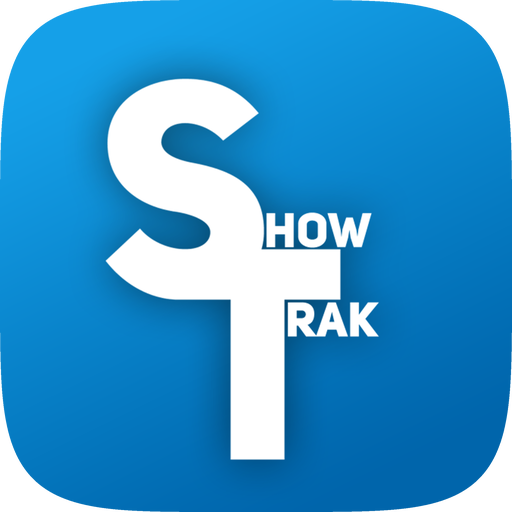

# ShowTrak Client

**The lightweight app that lets ShowTrak Server watch and control a computer.**

[Website](https://showtrak.co.uk/software/client) · [Download](https://showtrak.co.uk/software/client/downloads) · [Documentation](https://showtrak.co.uk/docs/client) · [Discord](https://discord.gg/DACmwsbSGW)

[![Windows][badge-windows]](https://showtrak.co.uk/software/client/downloads) [![macOS][badge-macos]](https://showtrak.co.uk/software/client/downloads) [![Linux][badge-linux]](https://showtrak.co.uk/software/client/downloads) [![Raspberry Pi][badge-raspberrypi]](https://showtrak.co.uk/software/client/downloads) [![CI status][badge-ci]](https://github.com/ShowTrak/ShowTrakClient/actions/workflows/ci.yml)

Install ShowTrak Client on every computer in your show: media playback machines, game PCs,
kiosks, control computers. It reports their health to
[ShowTrak Server](https://github.com/ShowTrak/ShowTrakServer) and carries out the actions you send
from it, so you can look after the whole rig from one screen.

## Key features

- **Set and forget**: runs quietly in the background, starts with the computer and reconnects by itself. Built to run unattended for weeks, with a small footprint.
- **Finds the server for you**: discovers ShowTrak Server on the local network, so there is nothing to type in.
- **Reports what matters**: CPU, memory, temperatures, storage, displays, audio devices, USB devices, network connections, battery and power, and which applications are running or not responding.
- **Runs your scripts**: restart an app, reboot, shut down or anything else you script, with the output streamed back live.
- **Run on startup, safely**: run a script when the computer boots, after an on-screen countdown you can cancel.
- **Identify**: flash a full-screen message on every display so you can find the machine in the rack.
- **No desktop needed**: on Linux it can run as a background service on machines without a screen.
- **Automatic updates**: choose the Stable or Beta channel and stay up to date.

## Getting started

1. Set up [ShowTrak Server](https://showtrak.co.uk/software/server/downloads) first.
2. [Download ShowTrak Client](https://showtrak.co.uk/software/client/downloads) and install it on each computer you want to monitor.
3. It appears in ShowTrak Server automatically. Adopt it with one click.

See the [ShowTrak Client guide](https://showtrak.co.uk/docs/client) for more.

## Part of ShowTrak

| App                                                           | What it does                                                                |
| ------------------------------------------------------------- | --------------------------------------------------------------------------- |
| **[ShowTrak Server](https://showtrak.co.uk/software/server)** | Monitor and control every computer and show device from one screen.         |
| **[ShowTrak Client](https://showtrak.co.uk/software/client)** | The lightweight app that lets ShowTrak Server watch and control a computer. |
| **[ShowTrak Timers](https://showtrak.co.uk/software/timers)** | Show timers run from the desk, a Stream Deck, QLab or any browser.          |
| **[ShowTrak Portal](https://showtrak.co.uk)**                 | Show reports, schedules and team collaboration for live productions.        |

Find everything at **[showtrak.co.uk](https://showtrak.co.uk)**.

## Support

Questions, ideas or problems? Join the [ShowTrak Discord](https://discord.gg/DACmwsbSGW) or [open an issue](https://github.com/ShowTrak/ShowTrakClient/issues).

## Licence

ShowTrak Client is free and open source under the [GNU AGPL-3.0](LICENSE).

[badge-windows]: https://img.shields.io/badge/Windows-0078D4?style=for-the-badge&logo=data:image/svg%2bxml;base64,PHN2ZyB4bWxucz0iaHR0cDovL3d3dy53My5vcmcvMjAwMC9zdmciIHZpZXdCb3g9IjAgMCAyNCAyNCI%2BPHBhdGggZmlsbD0iI2ZmZiIgZD0iTTAgMy40NDkgOS43NSAyLjF2OS40NTFIMG0xMC45NDktOS42MDJMMjQgMHYxMS40SDEwLjk0OU0wIDEyLjZoOS43NXY5LjQ1MUwwIDIwLjY5OU0xMC45NDkgMTIuNkgyNFYyNGwtMTIuOS0xLjgwMSIvPjwvc3ZnPg%3D%3D
[badge-macos]: https://img.shields.io/badge/macOS-000000?style=for-the-badge&logo=apple&logoColor=white
[badge-linux]: https://img.shields.io/badge/Linux-FCC624?style=for-the-badge&logo=linux&logoColor=black
[badge-raspberrypi]: https://img.shields.io/badge/Raspberry%20Pi-A22846?style=for-the-badge&logo=raspberrypi&logoColor=white
[badge-ci]: https://img.shields.io/github/actions/workflow/status/ShowTrak/ShowTrakClient/ci.yml?branch=main&style=for-the-badge&logo=githubactions&logoColor=white&label=CI
